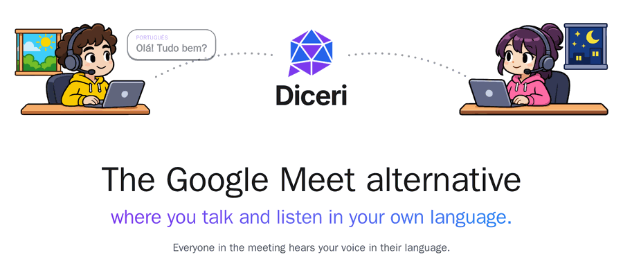
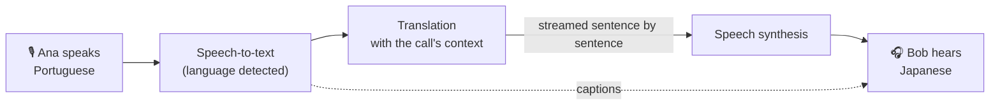

<p align="center">
  <a href="https://diceri.com">
    <picture>
      <source media="(prefers-color-scheme: dark)" srcset="docs/assets/diceri-dark.gif">
      
    </picture>
  </a>
</p>

<h1 align="center">Diceri</h1>

<p align="center">
  <b>The Google Meet alternative where you talk and listen in your own language.</b><br>
  Everyone in the meeting hears your voice in their language.
</p>

<p align="center">
  <a href="https://diceri.com"><b>diceri.com</b></a> ·
  <a href="docs/architecture.md">Architecture</a> ·
  <a href="docs/decisions/">Decisions</a> ·
  <a href="LICENSE">AGPL-3.0</a>
</p>

---

## What it is

Diceri is a video-call app with **live voice translation**. You speak your language; the
other person hears you, a moment later, in theirs, and you hear them in yours. No
subtitles to read and no interpreter to book: just a call, like the one you already use.

*Diceri* comes from Latin *dīcere*, "to say, to speak".

- **Your own room.** Claim an @ and your room lives at `diceri.com/@you`. Open it from
  `diceri.com/open`; guests sign in with their own @ and you decide whether they walk in or
  ask first.
- **Spoken, not subtitled.** Each listener picks the language they want to hear; every
  phrase is transcribed, translated and spoken on a track of its own, with live captions
  alongside.
- **Translated like an interpreter, not a dictionary.** The translation follows the whole
  conversation (what everyone said, not just the last sentence), so replies, references,
  idioms and tone come out the way a native speaker would say them.
- **Fast.** The translation streams straight into speech: the first sentence plays while
  the rest is still being translated.
- **In your own voice.** You record about 10 seconds once; translations are spoken as you,
  never by a stock voice. The recording is kept encrypted with your account and reused in
  every call until you choose "Delete my voice".
- **Private by default.** Rooms are unlisted, call audio and transcripts are never stored or
  logged, and participants reach the translator only under neutral labels.
- **Public beta.** Accounts are free and limited to 100 spots for now; the home page shows
  how many are left.

The interface speaks 12 languages; calls translate between 18, directly from one language
to another, never through English.

## How it works



A Rust **media agent** joins each call through [LiveKit](https://livekit.io), transcribes
every speaker, translates each phrase into every language someone in the room listens in,
and publishes the speech back as a track per language. The web app is a SvelteKit SPA;
the HTTP control plane is an [axum](https://github.com/tokio-rs/axum) API. Details, latency
budget and provider choices: [`docs/architecture.md`](docs/architecture.md) and
[`docs/decisions/`](docs/decisions/).

| Part | Built with |
| --- | --- |
| Web app | SvelteKit 3, Svelte 5 runes, Tailwind CSS 4, TypeScript |
| API and media agent | Rust 1.100 (axum, tokio), hexagonal crates: `domain` ← `application` ← `infra` |
| Media | LiveKit (WebRTC), Krisp noise filter |
| Speech and translation | ElevenLabs Scribe / Soniox, Gemini, Inworld TTS-2 voice clones (ElevenLabs selectable) |
| Storage | SQLite (accounts, plans, encrypted voice recordings) |

## Quick start

Requirements: Rust 1.100 (via rustup), Node 26 LTS, pnpm 12, [`just`](https://just.systems),
and the system packages in [`docs/development.md`](docs/development.md). Copy
`.env.example` to `.env` and fill in the provider keys you have.

```sh
just setup   # dependencies + git hooks
just dev     # API on :8090, web on :5180
just verify  # lint + tests: the gate before every push
just e2e     # end-to-end: real API, web and LiveKit with fake microphones
```

## Contributing

Read [`AGENTS.md`](AGENTS.md) first: it holds the rules for every contributor, human or AI
(project layout, size limits, testing, micro-commits). Testing layers are in
[`docs/testing.md`](docs/testing.md); deployment in [`docs/deployment.md`](docs/deployment.md).

## License

Diceri is free software under the [GNU Affero General Public License v3.0 only](LICENSE)
(`AGPL-3.0-only`). If you run a modified version as a network service, you must
offer its users the corresponding source code (AGPL section 13).

An [additional permission](LICENSE-EXCEPTION.md) (AGPL section 7) allows
combining Diceri with LiveKit's proprietary Krisp noise filter, which the web
app uses for noise and background-voice cancellation.
